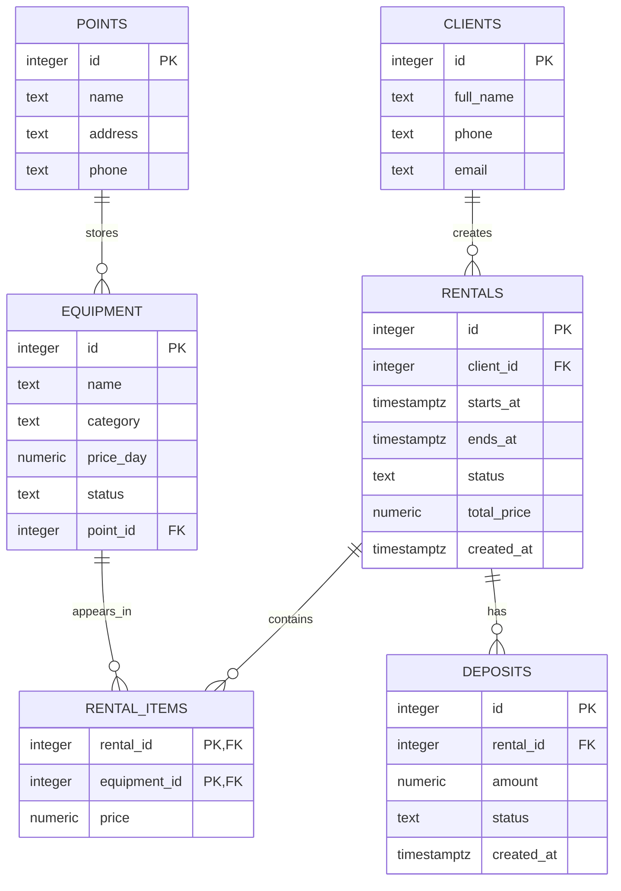

# Название проекта

Тема №15: **Прокат снаряжения**. База хранит данные о клиентах, пунктах проката,
единицах снаряжения, арендах и залогах. Нужна пунктам выдачи, чтобы вести учёт,
кто что взял, когда должен вернуть и сколько оставил в залог.

| | |
| --- | --- |
| Главная таблица | `equipment` — единицы снаряжения  |
| Связь N:M | `rentals` и `equipment` через `rental_items` |
| Бизнес-правило | Нельзя выдать единицу снаряжения, которая уже на руках |
| СУБД | PostgreSQL 17 в Docker |

## Задания курса

Правила курса, установка и порядок сдачи: [docs/README.md](docs/README.md).

| Лаба | Задание |
| --- | --- |
| 1. Модель данных и схема | [docs/lab-1.md](docs/lab-1.md) |
| 2. Запросы | [docs/lab-2.md](docs/lab-2.md) |
| 3. Логика в базе | [docs/lab-3.md](docs/lab-3.md) |
| 4. Транзакции и доступ | [docs/lab-4.md](docs/lab-4.md) |
| 5. Производительность | [docs/lab-5.md](docs/lab-5.md) |
| Витрина к защите | [docs/showcase.md](docs/showcase.md) |

## Как запустить

```bash
cp .env.example .env          # пароли и порт
docker compose up -d          # при первом запуске выполняются скрипты из db/
dbcheck run demo/lab1.sql     # сценарий лабы 1
```

Работа с базой: `docker compose exec db psql -U postgres -d app`. Сценарии выполняются в `psql` командой `\i /demo/lab1.sql`.

После изменения скриптов в `db/` базу нужно пересоздать: `docker compose down -v && docker compose up -d`.

## ER-диаграмма



## Ограничения

| Ограничение | Таблица и колонки | Зачем |
| --- | --- | --- |
| `UNIQUE` | `clients.email` | Один клиент — один email |
| `UNIQUE` | `equipment.serial_number` | Серийник единицы уникален |
| `UNIQUE` | `rental_items (rental_id, equipment_id)` | Одну единицу нельзя добавить в одну аренду дважды |
| `NOT NULL` | `clients.full_name`, `equipment.name`, `rentals.starts_at`, `rentals.ends_at` | Обязательные поля для заполнения |
| `CHECK` | `equipment.price_day > 0` | Цена аренды положительная |
| `CHECK` | `rentals.ends_at > starts_at` | Аренда заканчивается позже, чем начинается |
| `CHECK` | `equipment.status IN ('available','rented','repair')` | Статус — только из фиксированного списка |
| `CHECK` | `deposits.amount >= 0` | Залог не может быть отрицательным |

## Что сделано по лабам

| Лаба | Что сделано | Сценарий |
| --- | --- | --- |
| 1 | ... | `demo/lab1.sql` |
| 2 | ... | `demo/lab2.sql` |
| 3 | ... | `demo/lab3.sql` |
| 4 | ... | `demo/lab4.sql`, `demo/race.sql`, `demo/race_fixed.sql` |
| 5 | ... | `demo/lab5.sql` |

<!--
  Разделы, которые добавляются по ходу курса:
  лаба 1 ★: «Нормализация», «Типы данных»; ★★: «Что происходит при удалении»;
  лаба 4: «Гонка»;
  лаба 5: «Производительность» (таблица до / после, когда индекс не помогает, размеры).
-->
